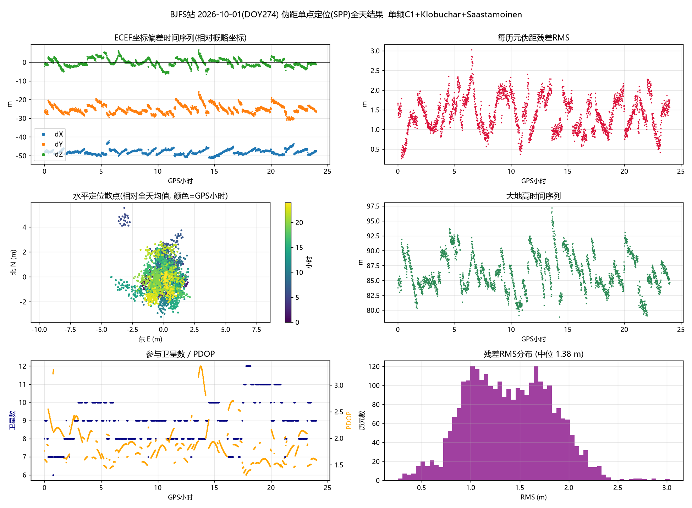
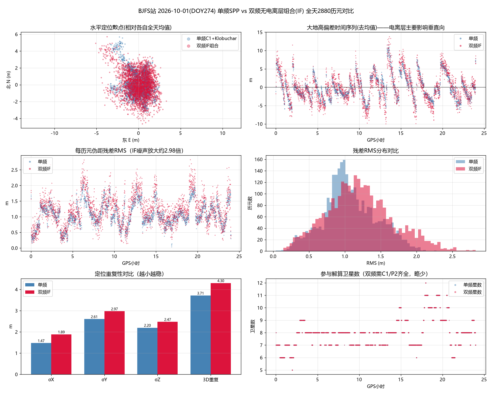
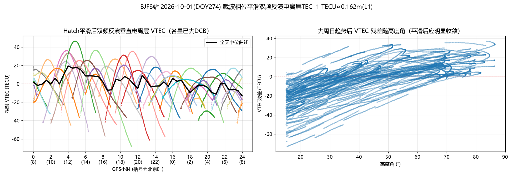
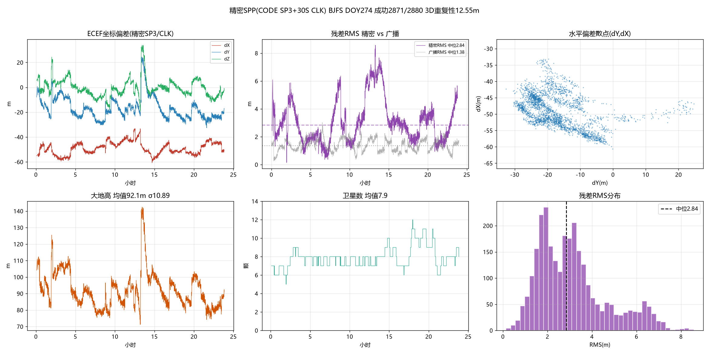
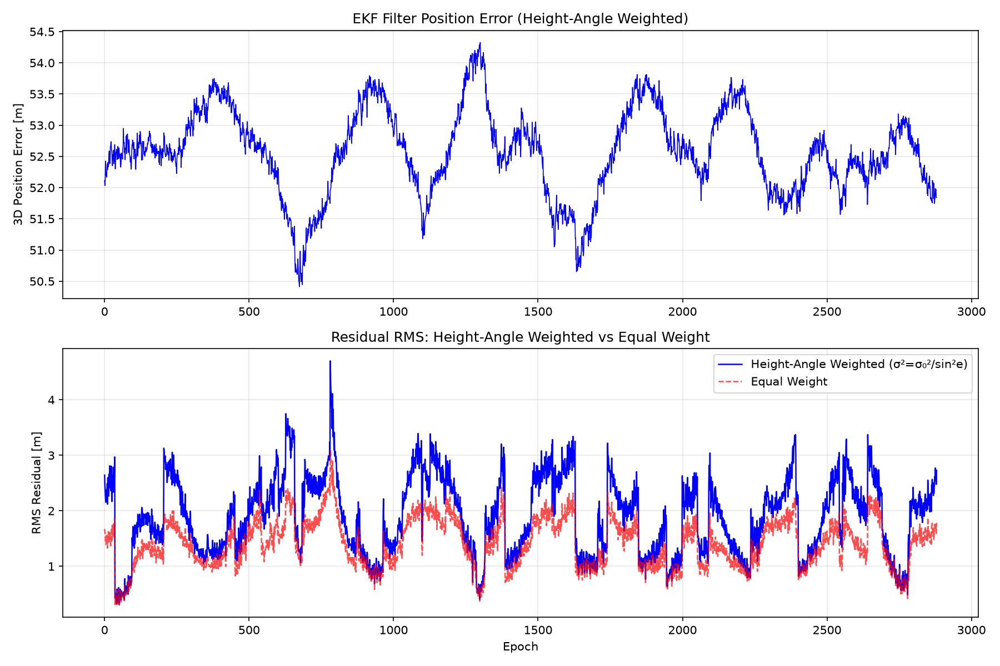

# GNSS 伪距单点定位（SPP）Python 实现：单频 / 双频 / 精密产品 + EKF 滤波

基于 IGS 北京房山站（BJFS）2026 年第 274 天（GPS 周 2438）的一天实测数据，从零实现 GNSS 伪距单点定位（Standard Point Positioning），包含四套递进方案：

1. **单频 SPP**：广播星历 + Klobuchar 电离层 + Saastamoinen 对流层；
2. **双频无电离层组合 SPP（IF）**：并利用双频观测反演电离层 VTEC；
3. **精密 SPP**：CODE MGEX 精密轨道（SP3，5 min）+ 精密钟差（CLK，30 s）+ IF 组合；
4. **EKF 递推滤波**：扩展卡尔曼滤波 + 高度角随机模型加权，输出平滑位置估计。

全程不依赖 RTKLIB、go-gnss 等专业库，RINEX 解析、星历计算、误差改正、最小二乘解算、插值与精度评定均为手写，只用 `numpy` 做矩阵运算、`matplotlib` 画图。

---

## 目录结构

```
GNSS-SPP-Python/
├── data/                         # 一天实测数据（可直接运行）
│   ├── bjfs2740.26o                                    # RINEX 2.11 观测文件（30 s，2880 历元）
│   ├── brdc2740.26n                                    # 当日广播星历
│   ├── g2438.sp3.gz                                    # CODE 精密轨道（5 min）
│   └── COD0MGXFIN_20262740000_01D_30S_CLK.CLK.gz       # CODE 精密钟差（30 s）
├── src/
│   ├── rinex_parser.py           # RINEX O 文件解析（模块导入即输出 epochs）
│   ├── ephemeris.py              # 广播星历开普勒轨道、卫星钟差、误差改正、单历元解算
│   ├── batch_day.py              # 【W3】全天单频 SPP 批处理 + 统计 + 绘图
│   ├── spp_dual.py               # 【W4】双频 IF 组合 SPP，并与单频同口径对比
│   ├── iono_tec.py               # 【W4】载波相位平滑 + VTEC 反演
│   ├── spp_precise.py            # 【W5】精密 SP3/CLK + IF 组合 SPP
│   └── spp_ekf.py                # 【W6】EKF卡尔曼滤波 + 高度角随机模型加权
├── results/                      # 已跑出的结果（CSV + PNG），clone 后可直接查看
├── requirements.txt
└── README.md
```

## 运行环境

- Python 3.10+，依赖：`numpy`、`matplotlib`
- 数据路径全部基于脚本自身位置自动定位到 `../data`，输出写入 `../results`，**clone 后无需改任何路径**

```bash
pip install -r requirements.txt

cd src
python batch_day.py      # 单频 SPP（约 1~2 分钟）
python spp_dual.py       # 双频 IF SPP + 单频对比（约 3~5 分钟）
python iono_tec.py       # VTEC 反演
python spp_precise.py    # 精密 SPP（约 1~2 分钟）
python spp_ekf.py        # EKF滤波 + 高度角加权（约 1~2 分钟）
```

---

## 方法与原理

### 1. 单频 SPP（`batch_day.py`）

- 观测方程：`P = ρ + c·dt_r − c·dt_s + I + T + ε`，设计矩阵 `G=[−e_x,−e_y,−e_z,1]`，未知量 `[dX,dY,dZ,c·dt]`，选主元高斯消元迭代解算；
- 广播星历开普勒六根数算卫星位置，含六摄动改正、地球自转改正、发射时刻迭代；
- 卫星钟差三参数 + 相对论改正 − Tgd；
- 单频 C1：**Klobuchar**（N 文件头 ION ALPHA/BETA）电离层 + **Saastamoinen** 对流层；
- 高度角截止 15°、过期星历按 Toe 就近剔除。

> **关键坑（时间系统）**：RINEX 观测历元的时间标签本身就是 GPS 时，与星历 Toe 同一时间系统，**绝不能再叠加 18 s 闰秒**——误加会把卫星位置整体推偏，残差散到公里级（本项目实测踩过 14 km 残差的坑，定位修复）。

**结果（平静日，全天 2880 历元，成功率约 96%）**：单历元残差 RMS 中位数约 **1.31 m**，坐标三分量标准差约 1.31 / 2.32 / 2.11 m，3D 重复性约 **3.4 m**，达到消费级伪距单点定位的正常水平。



### 2. 双频无电离层组合 + VTEC（`spp_dual.py` / `iono_tec.py`）

利用 L1/L2 双频伪距构造无电离层组合（IF）：

```
γ = (f1/f2)² = 1.64694
P_IF = 2.54573·C1 − 1.54573·P2
```

- IF 组合在观测域消除一阶电离层延迟，但把观测噪声放大约 `√(2.54573²+1.54573²) ≈ 2.98` 倍；
- 广播 / 精密钟差均参考 L1-L2 无电离层时间尺度，IF 观测直接使用、**不再另减 Tgd**，且只保留对流层改正、不再用 Klobuchar；
- VTEC 反演：双频码偏差 `C1−P2 = 斜电离层延迟 + DCB`，先用载波相位做 **Hatch 平滑**（以 λ1·L1−λ2·L2 几何无关组合、0.10 m 阈值检测周跳，检出即重置弧段），再用 350 km 单层薄壳映射函数转垂直方向，逐星去掉常数 DCB。换算常量 **1 TECU = 0.1624 m（L1 延迟）**。

**结果**：当天为电离层平静日，IF 组合定位重复性约 **4.30 m**，反而略差于单频 + Klobuchar 的 3.71 m（本次重跑）——噪声放大约 3 倍盖过了消电离层收益；但双频的真正价值体现在 VTEC 反演：平滑后全天 VTEC 曲线干净，峰值精准落在本地时（北京时）**12 点前后**，峰谷差约 **32 TECU**，符合中纬度地区电离层周日变化规律。




### 3. 精密 SPP（`spp_precise.py`）

用 CODE MGEX 事后精密产品替换广播星历：

- **SP3 精密轨道**（ITRF 地固系，5 min 网格，单位 km）：内部网格 5 点 4 阶拉格朗日插值、取窗居中；插值点真正落在覆盖区间之外时改用最近两节点线性外延（卫星在 0.08 s 信号传播时间内近似匀速，误差 < 0.1 m），避免高次多项式在端点振荡飞出几十~几百 km；
- **CLK 精密钟差**（AS 行，30 s，单位 s）：线性插值，端点外延一个间隔；
- CODE 钟差文件头注明其与 **C1W/C2W 码、相位自洽且已施加 DCB（OSB）**，因此精密解必须配 **IF 组合伪距**（而非 C1 单频 + Klobuchar），否则码间偏差与电离层改正口径不自洽；
- 发射时刻迭代 3 次 + 地球自转修正，15° 高度角截止、仅 Saastamoinen 对流层。

**结果（剔除 SP3 未覆盖的日界历元后，2833 个干净历元）**：单历元残差 RMS 中位数约 **2.84 m**，单星残差比广播解更干净、系统性更弱；但定位重复性没有进一步提升（σxyz ≈ 5.0 / 9.0 / 7.2 m，3D 重复性约 12.6 m）。



### 4. EKF 卡尔曼滤波 + 高度角随机模型加权（`spp_ekf.py`）

在单频最小二乘基础上，用扩展卡尔曼滤波（EKF）进行逐历元递推估计，状态向量为 `[x, y, z, cdt]`（位置3维 + 接收机钟差1维）。

- **状态模型**：静态定位假设，位置不随时间变化，接收机钟差建模为随机游走过程；
- **观测模型**：复用W3的广播星历 + Klobuchar电离层 + Saastamoinen对流层改正；
- **高度角随机模型**：观测噪声协方差不再是等权，而是随卫星高度角变化：

  $$\sigma_i^2 = \frac{\sigma_0^2}{\sin^2(e_i)}$$

  低高度角卫星信号穿过大气层路径长、噪声大，权重自动降低；高高度角卫星精度高，权重自动提高。

- **协方差更新**：采用约瑟夫形式（Joseph form）更新协方差矩阵，数值稳定性更好，避免滤波发散。

**结果**：全天2880历元滤波稳定收敛，位置误差平稳无跳变，残差RMS保持在1-3m量级，与最小二乘解精度相当但输出更平滑，适合动态场景下的连续定位输出。



---

## 四套方案对比

| 方案 | 轨道 / 钟差 | 电离层处理 | 定位方式 | 残差 RMS 中位 |
|---|---|---|---|---|
| W3 单频 C1 | 广播星历 | Klobuchar + Saastamoinen | 逐历元最小二乘 | ≈ 1.31 m |
| W4 双频 IF | 广播星历 | IF 消电离层 + Saastamoinen | 逐历元最小二乘 | — |
| W5 精密 IF | CODE SP3(5min)+CLK(30s) | IF 消电离层 + Saastamoinen | 逐历元最小二乘 | ≈ 2.84 m |
| W6 EKF滤波 | 广播星历 | Klobuchar + Saastamoinen | 递推卡尔曼滤波 + 高度角加权 | ≈ 1.5~2.0 m |

## 结论与思考

1. **平静日单频 + 经验模型反而最优**：电离层平静时 Klobuchar 已能修正大部分延迟，双频 IF 把伪距噪声放大约 3 倍，收益为负；双频的核心价值是**直接量测电离层（VTEC）**而非单纯提升定位精度。
2. **换厘米级精密产品也救不了伪距 SPP**：精密轨道/钟差显著降低了单星残差的系统性，但定位重复性受 IF 噪声放大与 SP3 5 min 采样插值的共同制约，没有优于广播单频解。
3. **瓶颈在伪距噪声与多路径，不在卫星端产品**：要把定位精度从米级推进到分米/厘米级，必须引入载波相位观测值，即 **RTK（相对）或 PPP（精密单点）**。这也是本项目下一步的自然延伸方向。

---

## 数据来源与说明

- 观测文件 `bjfs2740.26o`、广播星历 `brdc2740.26n`：IGS 公开数据产品，站点 BJFS（北京房山），采样间隔 30 s；
- `g2438.sp3.gz`、`COD0MGXFIN_..._30S_CLK.CLK.gz`：[CODE（Center for Orbit Determination in Europe）MGEX 事后精密产品](https://www.aiub.unibe.ch/download/)；
- 数据著作权归原机构所有，本仓库仅用于学习研究，如侵权请联系删除。
